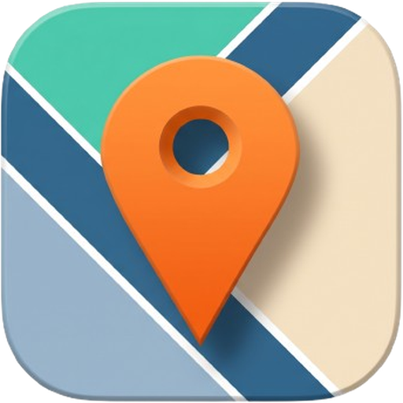
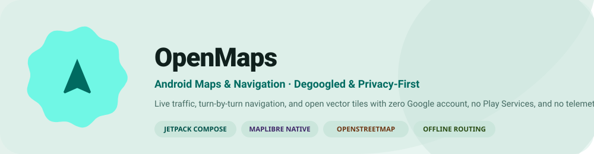
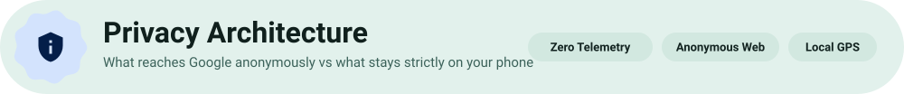
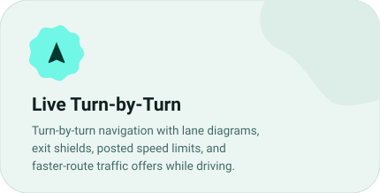
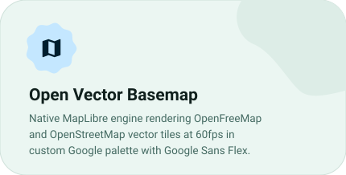
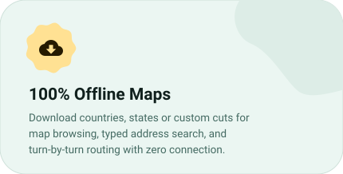
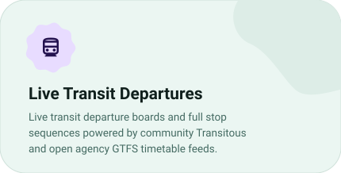
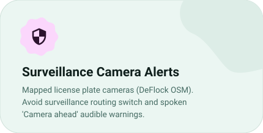
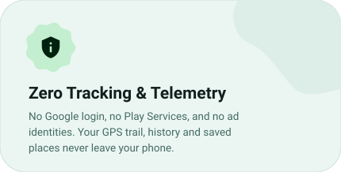
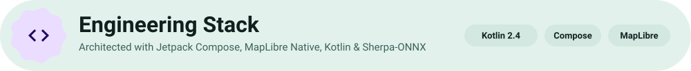

<div align="center">



<picture>
  <source media="(prefers-color-scheme: dark) and (max-width: 640px)" srcset="assets/readme/dark/hm-hero.svg">
  <source media="(prefers-color-scheme: dark)" srcset="assets/readme/dark/h-hero.svg">
  <source media="(max-width: 640px)" srcset="assets/readme/light/hm-hero.svg">
  
</picture>

<br><br>

<p align="center">
  <a href="https://github.com/smartworldarafath/OpenMaps/releases/latest"><picture><source media="(prefers-color-scheme: dark)" srcset="assets/readme/dark/btn-download.svg"></picture></a>
  <a href="https://github.com/smartworldarafath/OpenMaps"><picture><source media="(prefers-color-scheme: dark)" srcset="assets/readme/dark/btn-github.svg"></picture></a>
  <a href="https://smartworldarafath.github.io/OpenMaps/docs/"><picture><source media="(prefers-color-scheme: dark)" srcset="assets/readme/dark/btn-docs.svg"></picture></a>
  <a href="https://github.com/smartworldarafath/OpenMaps/issues"><picture><source media="(prefers-color-scheme: dark)" srcset="assets/readme/dark/btn-issues.svg"></picture></a>
</p>

<p align="center">
  <a href="#overview" title="Android 8.0+ Compatible"><picture><source media="(prefers-color-scheme: dark)" srcset="assets/readme/dark/badge-android.svg"></picture></a>
  <a href="#comparison" title="100% Client-Side"><picture><source media="(prefers-color-scheme: dark)" srcset="assets/readme/dark/badge-clientonly.svg"></picture></a>
  <a href="#comparison" title="Zero Telemetry & Tracking"><picture><source media="(prefers-color-scheme: dark)" srcset="assets/readme/dark/badge-zerotracking.svg"></picture></a>
  <a href="#stack" title="Jetpack Compose"><picture><source media="(prefers-color-scheme: dark)" srcset="assets/readme/dark/badge-compose.svg"></picture></a>
  <a href="#stack" title="MapLibre Native"><picture><source media="(prefers-color-scheme: dark)" srcset="assets/readme/dark/badge-maplibre.svg"></picture></a>
  <a href="#overview" title="OpenStreetMap"><picture><source media="(prefers-color-scheme: dark)" srcset="assets/readme/dark/badge-osm.svg"></picture></a>
  <a href="#features" title="Offline Navigation"><picture><source media="(prefers-color-scheme: dark)" srcset="assets/readme/dark/badge-offline.svg"></picture></a>
  <a href="LICENSE" title="MIT License"><picture><source media="(prefers-color-scheme: dark)" srcset="assets/readme/dark/badge-mit.svg"></picture></a>
  <a href="https://github.com/smartworldarafath/OpenMaps/pulls" title="Pull Requests Welcome"><picture><source media="(prefers-color-scheme: dark)" srcset="assets/readme/dark/badge-prs.svg"></picture></a>
</p>

</div>

<h3 id="overview"><picture><source media="(prefers-color-scheme: dark) and (max-width: 640px)" srcset="assets/readme/dark/hm-overview.svg"><source media="(prefers-color-scheme: dark)" srcset="assets/readme/dark/h-overview.svg"><source media="(max-width: 640px)" srcset="assets/readme/light/hm-overview.svg"></picture></h3>

**OpenMaps** is an open-source, privacy-first Google Maps alternative for Android: *what NewPipe is to YouTube, but for maps and navigation.* 

The map basemap is built on open vector tiles (**OpenStreetMap** via OpenFreeMap), and the places on it are open datasets (**Overture Maps** and **AllThePlaces**). Browsing the map never sends any request to Google. When you search, tap a place for hours, or calculate driving routes with live traffic, your phone queries public web endpoints directly without an account, shared API key, or tracking proxy. Built especially for degoogled setups such as **GrapheneOS**, it runs equally fast on stock Android.

<table width="100%"><thead><tr><th align="left" width="28%">Quick facts</th><th align="left">Details</th></tr></thead><tbody>
<tr><td><b>App name</b></td><td>OpenMaps (<code>app.OpenMaps</code>)</td></tr>
<tr><td><b>Platform</b></td><td>Android 8.0+ (ARM64, x86_64) · Optimized for GrapheneOS &amp; Stock Android</td></tr>
<tr><td><b>UI Architecture</b></td><td>Jetpack Compose · Material 3 Expressive UI · Dynamic Theming</td></tr>
<tr><td><b>Map Engine</b></td><td>MapLibre Native Android SDK (Fast 60fps vector tile rendering)</td></tr>
<tr><td><b>Basemap Data</b></td><td>OpenStreetMap vector tiles served by OpenFreeMap (Liberty style)</td></tr>
<tr><td><b>Place Data</b></td><td>Overture Maps &amp; AllThePlaces baked into compact vector tiles</td></tr>
<tr><td><b>Routing Engine</b></td><td>OSRM &amp; Valhalla (online/offline hybrid) + OsmAnd OBF on-device routing</td></tr>
<tr><td><b>Voice Navigation</b></td><td>Sherpa-ONNX on-device neural text-to-speech (Zero speech data leaves device)</td></tr>
<tr><td><b>Public Transit</b></td><td>Transitous community engine + open agency GTFS timetable feeds</td></tr>
<tr><td><b>Telemetry</b></td><td>100% Client-Side · Zero telemetry · No Google Play Services · No Firebase</td></tr>
<tr><td><b>License</b></td><td>MIT License (100% Free &amp; Open Source)</td></tr>
</tbody></table>

<div align="center">

| Action | Direct Link |
|:---|:---|
| **Download Stable APK** | [GitHub Releases Latest](https://github.com/smartworldarafath/OpenMaps/releases/latest) |
| **Searchable Documentation** | [smartworldarafath.github.io/OpenMaps/docs](https://smartworldarafath.github.io/OpenMaps/docs/) |
| **Source Code Repository** | [smartworldarafath/OpenMaps](https://github.com/smartworldarafath/OpenMaps) |
| **Bug Reports & Feedback** | [GitHub Issues Tracker](https://github.com/smartworldarafath/OpenMaps/issues) |
| **Pull Requests** | [GitHub Pull Requests](https://github.com/smartworldarafath/OpenMaps/pulls) |
| **Open Source License** | [MIT License](LICENSE) |

<br>

<a href="https://github.com/smartworldarafath/OpenMaps/releases"><picture><source media="(prefers-color-scheme: dark)" srcset="assets/readme/dark/btn-releases.svg"></picture></a>
<a href="https://github.com/smartworldarafath/OpenMaps/issues"><picture><source media="(prefers-color-scheme: dark)" srcset="assets/readme/dark/btn-issues.svg"></picture></a>
<a href="LICENSE"><picture><source media="(prefers-color-scheme: dark)" srcset="assets/readme/dark/btn-license.svg"></picture></a>

</div>

<h3 id="comparison"><picture><source media="(prefers-color-scheme: dark) and (max-width: 640px)" srcset="assets/readme/dark/hm-comparison.svg"><source media="(prefers-color-scheme: dark)" srcset="assets/readme/dark/h-comparison.svg"><source media="(max-width: 640px)" srcset="assets/readme/light/hm-comparison.svg"></picture></h3>

OpenMaps acts as a self-contained client. It does not run Google Play Services or proprietary SDKs, nor does it log you in.

<table width="100%"><thead><tr><th align="left" width="28%">Action / Activity</th><th align="left">Network Behavior &amp; Data Exposure</th></tr></thead><tbody>
<tr><td><b>Pan, zoom &amp; browse map</b></td><td><b>Nothing reaches Google.</b> Tiles are fetched from OpenFreeMap, and streets/labels come from OpenStreetMap.</td></tr>
<tr><td><b>Place markers on map</b></td><td><b>Nothing reaches Google</b> where OpenMaps has baked place data (Overture &amp; AllThePlaces).</td></tr>
<tr><td><b>Drop a pin / house numbers</b></td><td><b>Nothing reaches Google.</b> Resolved via open Nominatim geocoding.</td></tr>
<tr><td><b>Departure boards &amp; transit</b></td><td><b>Nothing reaches Google</b> for stops covered by Transitous open data.</td></tr>
<tr><td><b>Driving directions &amp; traffic</b></td><td><b>Anonymous trip query.</b> Driving routes query Google anonymously for traffic and road closures. Open routers (OSRM/Valhalla) provide turn instructions.</td></tr>
<tr><td><b>Search autocompletion</b></td><td><b>Anonymous text query.</b> Autocomplete text sends logged-out queries only when you pause.</td></tr>
<tr><td><b>Place hours &amp; reviews</b></td><td><b>Anonymous place lookup.</b> Query hours, photos, and reviews under a clean, logged-out session cookie.</td></tr>
<tr><td><b>Saved places, history &amp; GPS</b></td><td><b>100% Local.</b> Your history, favorites, and live GPS coordinates never leave your device.</td></tr>
</tbody></table>

<h3 id="screenshots"><picture><source media="(prefers-color-scheme: dark) and (max-width: 640px)" srcset="assets/readme/dark/hm-screenshots.svg"><source media="(prefers-color-scheme: dark)" srcset="assets/readme/dark/h-screenshots.svg"><source media="(max-width: 640px)" srcset="assets/readme/light/hm-screenshots.svg"></picture></h3>

<div align="center">

<table width="100%">
  <tr>
    <td width="33%" align="center" valign="top">
      <br><br>
      <b>🧭 Live Navigation</b><br>
      <sub>Lane diagrams, exit shields, live speedometer, posted speed limit alerts, and traffic offers.</sub>
    </td>
    <td width="33%" align="center" valign="top">
      <br><br>
      <b>🗺️ Vector Basemap</b><br>
      <sub>OpenFreeMap vector tiles rendered at high refresh rates with Google Sans Flex typography.</sub>
    </td>
    <td width="33%" align="center" valign="top">
      <br><br>
      <b>📍 Place Details</b><br>
      <sub>Live opening hours, photos, reviews, contact information, and busy periods.</sub>
    </td>
  </tr>
  <tr>
    <td width="33%" align="center" valign="top">
      <br><br>
      <b>🚗 Route Alternatives</b><br>
      <sub>Compare alternate routes, avoid tolls or highways, and inspect real-time traffic delays.</sub>
    </td>
    <td width="33%" align="center" valign="top">
      <br><br>
      <b>🔍 Smart Search</b><br>
      <sub>Instant search across restaurants, landmarks, addresses, and local services.</sub>
    </td>
    <td width="33%" align="center" valign="top">
      <br><br>
      <b>🚆 Transit Routing</b><br>
      <sub>Subway, train, and bus transit routing with live line badges and transfer instructions.</sub>
    </td>
  </tr>
  <tr>
    <td width="33%" align="center" valign="top">
      <br><br>
      <b>🚍 Transit Departures</b><br>
      <sub>Real-time departure boards and stop sequences from Transitous open timetable networks.</sub>
    </td>
    <td width="33%" align="center" valign="top">
      <br><br>
      <b>📋 Stop Schedules</b><br>
      <sub>Complete line stop list, intermediate platform timing, and connecting options.</sub>
    </td>
    <td width="33%" align="center" valign="top">
      <br><br>
      <b>☀️ Light Theme Map</b><br>
      <sub>Full dynamic theming support with high-contrast road layouts and dark/light switching.</sub>
    </td>
  </tr>
</table>

</div>

<h3 id="features"><picture><source media="(prefers-color-scheme: dark) and (max-width: 640px)" srcset="assets/readme/dark/hm-features.svg"><source media="(prefers-color-scheme: dark)" srcset="assets/readme/dark/h-features.svg"><source media="(max-width: 640px)" srcset="assets/readme/light/hm-features.svg"></picture></h3>

<div align="center">

| | |
|:---:|:---:|
| <a href="#features" title="Live Turn-by-Turn Navigation"><picture><source media="(prefers-color-scheme: dark)" srcset="assets/readme/dark/card-navigation.svg"></picture></a> | <a href="#overview" title="Open Vector Basemaps"><picture><source media="(prefers-color-scheme: dark)" srcset="assets/readme/dark/card-basemap.svg"></picture></a> |
| <a href="#features" title="100% Offline Maps"><picture><source media="(prefers-color-scheme: dark)" srcset="assets/readme/dark/card-offline.svg"></picture></a> | <a href="#features" title="Open Places & Live Info"><picture><source media="(prefers-color-scheme: dark)" srcset="assets/readme/dark/card-places.svg"></picture></a> |
| <a href="#features" title="Live Transit Departures"><picture><source media="(prefers-color-scheme: dark)" srcset="assets/readme/dark/card-transit.svg"></picture></a> | <a href="#features" title="On-Device Neural Voice"><picture><source media="(prefers-color-scheme: dark)" srcset="assets/readme/dark/card-voice.svg"></picture></a> |
| <a href="#features" title="Surveillance Camera Alerts"><picture><source media="(prefers-color-scheme: dark)" srcset="assets/readme/dark/card-camera.svg"></picture></a> | <a href="#comparison" title="Zero Tracking & Telemetry"><picture><source media="(prefers-color-scheme: dark)" srcset="assets/readme/dark/card-privacy.svg"></picture></a> |

</div>

<h3 id="stack"><picture><source media="(prefers-color-scheme: dark) and (max-width: 640px)" srcset="assets/readme/dark/hm-stack.svg"><source media="(prefers-color-scheme: dark)" srcset="assets/readme/dark/h-stack.svg"><source media="(max-width: 640px)" srcset="assets/readme/light/hm-stack.svg"></picture></h3>

<div align="center">

<picture><source media="(prefers-color-scheme: dark)" srcset="assets/readme/dark/pill-kotlin.svg"></picture>
<picture><source media="(prefers-color-scheme: dark)" srcset="assets/readme/dark/pill-compose.svg"></picture>
<picture><source media="(prefers-color-scheme: dark)" srcset="assets/readme/dark/pill-maplibre.svg"></picture>
<picture><source media="(prefers-color-scheme: dark)" srcset="assets/readme/dark/pill-android.svg"></picture>
<br><br>
<picture><source media="(prefers-color-scheme: dark)" srcset="assets/readme/dark/pill-osm.svg"></picture>
<picture><source media="(prefers-color-scheme: dark)" srcset="assets/readme/dark/pill-routing.svg"></picture>
<picture><source media="(prefers-color-scheme: dark)" srcset="assets/readme/dark/pill-voice.svg"></picture>
<picture><source media="(prefers-color-scheme: dark)" srcset="assets/readme/dark/pill-okhttp.svg"></picture>
<picture><source media="(prefers-color-scheme: dark)" srcset="assets/readme/dark/pill-mit.svg"></picture>

</div>

<br>

<table width="100%"><thead><tr><th align="left" width="24%">Layer</th><th align="left" width="36%">Technology</th><th align="left">Purpose &amp; Architecture Role</th></tr></thead><tbody>
<tr><td><b>Language</b></td><td>Kotlin 2.4 + Coroutines &amp; Flows</td><td>Modern null-safe asynchronous programming across background tasks and UI states.</td></tr>
<tr><td><b>UI System</b></td><td>Jetpack Compose &amp; Material 3</td><td>Declarative UI layouts, dynamic color palettes, gesture sheets, and D-pad keypad navigation.</td></tr>
<tr><td><b>Map Engine</b></td><td>MapLibre Native (C++ / Android)</td><td>Hardware-accelerated vector tile rendering at high frame rates with custom styling layers.</td></tr>
<tr><td><b>Basemap Tiles</b></td><td>OpenFreeMap &amp; OpenStreetMap</td><td>Community vector basemaps with zero mandatory API keys or cloud tokens.</td></tr>
<tr><td><b>Place Data</b></td><td>Overture Maps &amp; AllThePlaces</td><td>Open global POI coverage baked into region tiles and streamed on demand.</td></tr>
<tr><td><b>Routing &amp; Guidance</b></td><td>OSRM, Valhalla &amp; OsmAnd OBF</td><td>Turn-by-turn instruction synthesis, offline vehicle routing, and lane guidance.</td></tr>
<tr><td><b>Neural Voice</b></td><td>Sherpa-ONNX &amp; Piper TTS</td><td>On-device natural spoken directions with zero cloud speech transmission.</td></tr>
<tr><td><b>Networking</b></td><td>OkHttp &amp; Cronet</td><td>Reliable HTTP/2 client with isolated timeout handling and resilient fallbacks.</td></tr>
</tbody></table>

<h3 id="install"><picture><source media="(prefers-color-scheme: dark) and (max-width: 640px)" srcset="assets/readme/dark/hm-install.svg"><source media="(prefers-color-scheme: dark)" srcset="assets/readme/dark/h-install.svg"><source media="(max-width: 640px)" srcset="assets/readme/light/hm-install.svg"></picture></h3>

#### 1. Download Prebuilt APK
Download the latest signed release APK directly from GitHub:
- **[Latest Stable Release](https://github.com/smartworldarafath/OpenMaps/releases/latest)**

#### 2. Verify Release Certificate
Every OpenMaps release APK is signed with a stable release key. You can verify your downloaded APK using `apksigner`:

```bash
apksigner verify --print-certs OpenMaps-*.apk
```

Expected Certificate SHA-256 Fingerprint:
```
SHA-256  29:93:8B:48:58:06:3E:42:E6:77:FF:95:C9:01:CD:48:24:8A:7F:03:2A:3A:E8:5F:9B:9E:56:17:56:8B:0D:36
```

#### 3. Building From Source

```bash
# 1. Clone the repository
git clone https://github.com/smartworldarafath/OpenMaps.git
cd OpenMaps

# 2. Assemble release APK
./gradlew :app:assembleRelease

# 3. Output location
# app/build/outputs/apk/release/
```

<h3 id="faq"><picture><source media="(prefers-color-scheme: dark) and (max-width: 640px)" srcset="assets/readme/dark/hm-faq.svg"><source media="(prefers-color-scheme: dark)" srcset="assets/readme/dark/h-faq.svg"><source media="(max-width: 640px)" srcset="assets/readme/light/hm-faq.svg"></picture></h3>

**Why does OpenMaps connect to Google endpoints?**  
Open-source map datasets alone lack comprehensive business hours, reviews, photos, and real-time live traffic congestion. OpenMaps queries Google's public endpoints anonymously—exactly the way a logged-out web browser does—without an account, tracking identifiers, or server in the middle.

**Can I use OpenMaps completely offline?**  
Yes. You can download an entire state, country, or custom bounding box. Once downloaded, the vector map, address geocoding, and turn-by-turn routing operate with zero internet connectivity. Toggle **Settings → Privacy → Use OpenMaps without Google** to turn off all external calls.

**Does OpenMaps work on GrapheneOS without Google Play Services?**  
Yes. OpenMaps uses standard Android framework APIs (`LocationManager` and Android TTS) rather than proprietary Google Play Services location providers. It runs flawlessly on completely degoogled ROMs.

**Are my saved places and trips backed up to any cloud?**  
No. Your lists, saved routes, search history, and settings live strictly inside your phone's private app storage. You can export or restore your data to a local file at any time.

<h3 id="license"><picture><source media="(prefers-color-scheme: dark) and (max-width: 640px)" srcset="assets/readme/dark/hm-license.svg"><source media="(prefers-color-scheme: dark)" srcset="assets/readme/dark/h-license.svg"><source media="(max-width: 640px)" srcset="assets/readme/light/hm-license.svg"></picture></h3>

OpenMaps is free software licensed under the **[MIT License](LICENSE)** © 2026 Arafath.

#### Data Attributions
* **Map Data**: [OpenStreetMap](https://www.openstreetmap.org/copyright) © OpenStreetMap contributors, licensed under the Open Database License (ODbL). Vector tiles served by [OpenFreeMap](https://openfreemap.org).
* **Places Data**: [Overture Maps Foundation](https://overturemaps.org/) (CDLA-Permissive 2.0) and [AllThePlaces](https://www.alltheplaces.xyz/).
* **Closed Places Verification**: Foursquare OS Places (Apache 2.0), OpenStreetMap, and Wikidata.
* **Transit Schedules**: [Transitous](https://transitous.org/) and official public agency GTFS timetable feeds.
* **Typography**: Google Sans Flex font, copyright The Google Sans Flex Authors, under the [SIL Open Font License 1.1](app/src/main/assets/licenses/GoogleSansFlex-OFL.txt). OpenMaps is not affiliated with or endorsed by Google LLC.

<div align="center">
<sub>Search terms: OpenMaps, degoogled maps, Android navigation, Jetpack Compose map, MapLibre Android, OpenStreetMap navigation, GrapheneOS maps, offline GPS navigation, turn-by-turn routing, Overture maps android, privacy navigation.</sub>
</div>
